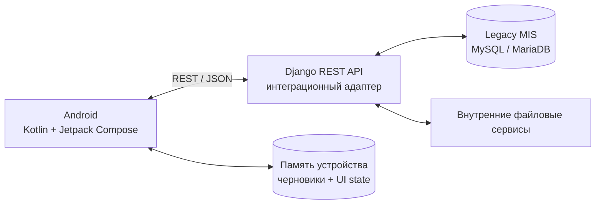

SAMSON Hospital — мобильное рабочее место врача для legacy-МИС
О конфиденциальности
SAMSON Hospital — внутреннее медицинское приложение для работы в закрытом контуре. В публичном репозитории размещены только обезличенные материалы портфолио и техническая документация. Исходный production-код, учетные данные, реальные данные пациентов и параметры развертывания не публикуются.

SAMSON Hospital — Android-приложение для врачей стационара, интегрированное с действующей настольной медицинской информационной системой. Основная задача проекта — перенести ключевые клинические сценарии на мобильное устройство без изменения базовой схемы БД МИС.
Реализованные сценарии
- работа со списком пациентов отделения;
- создание и просмотр дневников;
- локальные офлайн-черновики дневников;
- просмотр анализов и создание направлений;
- диагностика и направления на исследования;
- лечение и листы назначений;
- клинические мероприятия и документы;
- динамические формы, формируемые из метаданных МИС.
Моя роль на проекте
Full-cycle разработка:
- Android-клиент на Kotlin / Jetpack Compose;
- Django REST API;
- анализ legacy-схемы MySQL / MariaDB;
- динамическое построение форм по ActionType / ActionPropertyType;
- совместимая запись в структуры существующей МИС;
- UX/UI для работы врача на планшете и телефоне;
- локальное хранение черновиков и пользовательского состояния на устройстве;
- диагностика интеграции, логирование и отладка;
- пользовательская и developer-документация.
Архитектура

Главный архитектурный принцип: мобильное приложение не создает отдельную медицинскую модель данных и не меняет базовую схему МИС. Backend интерпретирует существующие метаданные и формирует стабильный REST-контракт для Android-клиента.
UX/UI и офлайн
Интерфейс проектировался под рабочие сценарии медицинского учреждения:
- Material 3 и Jetpack Compose;
- работа на планшетах и телефонах;
- настройка темы и размера текста;
- компактная навигация вокруг пациента;
- локальные шаблоны и избранное;
- сохранение черновиков дневников в памяти устройства;
- продолжение работы с черновиком после восстановления соединения.
Скриншоты
Все изображения обезличены.

Основное меню приложения

Меню пациента	

Типы дневников и локальные черновики
	
Динамическая форма дневника	

Результаты лабораторных исследований

История диагностики

Лечение и назначения

Клинические мероприятия

Динамическое разделение полей направления и результата

При создании направления приложение разрешает ввод параметров, относящихся к назначению, и отдельно блокирует поля, которые должны заполняться только после выполнения исследования.
Стек
- Android: Kotlin, Jetpack Compose, Material 3, Navigation Compose, Retrofit, OkHttp, Coroutines, JVM 17
- Backend: Python, Django, Django REST Framework, REST/JSON
- БД: MySQL / MariaDB
- Инфраструктура: CentOS, RED OS, Astra Linux
- Инструменты: Git, Postman, Insomnia
Документы
- [Презентация проекта (PDF)](docs/SAMSON_Hospital_Portfolio_2026.pdf)
- [Презентация проекта (PPTX)](docs/SAMSON_Hospital_Portfolio_2026.pptx)
- [Инструкция пользователя](docs/SAMSON_Hospital_User_Guide_2026.docx)
- [Developer Guide (DOCX)](docs/SAMSON_Hospital_Developer_Guide_2026.docx)
- [Developer Guide (Markdown)](docs/SAMSON_Hospital_Developer_Guide_2026.md)
Состав публичного репозитория
Репозиторий предназначен для портфолио и демонстрирует архитектуру, UX/UI, интеграционные решения и техническую документацию проекта. Production-код и медицинские данные не публикуются.
